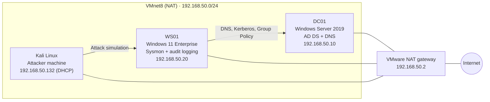

# SOC Home Lab – Active Directory Detection Lab

## Overview
I built a small Windows domain on VMware Workstation Pro to generate and investigate real security logs. The lab has a domain controller, a domain-joined Windows 11 workstation with Sysmon and advanced audit logging, and a Kali Linux machine for attack simulation. It gives me a safe environment to practise the same detection and triage work a SOC analyst does on live alerts.

## Lab Diagram

## Machines
| Host | Operating system | Role | IP address | RAM |
|---|---|---|---|---|
| DC01 | Windows Server 2019 | Domain controller (AD DS), DNS | 192.168.50.10 (static) | 4 GB |
| WS01 | Windows 11 Enterprise | Domain-joined workstation (victim) | 192.168.50.20 (static) | 4 GB |
| Kali | Kali Linux | Attacker | 192.168.50.132 (DHCP) | 4 GB |

Host: Intel Core i7 (13th gen), 32 GB RAM · Hypervisor: VMware Workstation Pro · Network: VMnet8 NAT

## Active Directory Build
Domain: **soclab.local** (NetBIOS: SOCLAB)

| OU | Objects |
|---|---|
| Staff | a.musa, j.okafor, k.danjuma, t.adeyemi |
| IT Admins | f.okoro (member of Domain Admins) |
| Workstations | WS01 |

## Logging Configuration
**Sysmon** installed on WS01 with the SwiftOnSecurity community configuration. Key events: 1 (process creation), 3 (network connection), 11 (file created), 13 (registry value set).

**Audit policy** created as a Group Policy Object (SOC Audit Policy) linked to soclab.local:

| Audit subcategory | Setting | Main Event IDs |
|---|---|---|
| Credential Validation | Success, Failure | 4776 |
| Kerberos Authentication Service | Success, Failure | 4768, 4771 |
| User Account Management | Success, Failure | 4720, 4726, 4738 |
| Security Group Management | Success, Failure | 4728, 4732 |
| Process Creation | Success | 4688 |
| Logon | Success, Failure | 4624, 4625 |
| Logoff | Success | 4634 |
| Special Logon | Success | 4672 |
| Audit Policy Change | Success, Failure | 4719 |

Also enabled: **command line in process creation events** (full command line in 4688) and **PowerShell Script Block Logging** (4104).

## Verification
Test: ran `whoami /groups` on WS01 and confirmed Event 4688 recorded the process `whoami.exe` in the Security log.

## Troubleshooting Notes
- **Audit GPO applied but not enforced.** `gpresult /r` showed SOC Audit Policy as applied on WS01, but `auditpol /get` reported "No Auditing", even after `gpupdate /force` and a restart. To keep logging running, I enabled the key subcategories locally with `auditpol /set`, then continued troubleshooting the GPO. Lesson: always verify that a security control is actually in effect, not just configured.
- **Keyboard layout.** WS01 was installed with the UK layout, which broke the backslash key (needed for `SOCLAB\user` logons). Fixed by adding the US layout and copying it to the welcome screen and new user accounts.
- **Server 2022 install failure.** The Windows Server 2022 ISO would not install, so the domain controller uses Windows Server 2019.

## Screenshots
**DC01 network configuration**

**OUs and users in Active Directory**

**Domain user logged on to WS01**

**WS01 in the Workstations OU**

**Sysmon recording events**

**SOC Audit Policy settings**

**Event 4688 – whoami.exe captured**

**Kali on the lab network**

## Skills Demonstrated
- Building an Active Directory domain: DC promotion, DNS, OUs, users, groups
- Joining a workstation to a domain and configuring static IP and DNS
- Configuring Windows advanced audit policy through Group Policy
- Deploying Sysmon with a community configuration
- Finding and reading security events in Event Viewer (4688)
- Troubleshooting Group Policy with gpresult and auditpol

## Next Steps
- Simulate attacks from Kali (password brute force, new admin account, malicious PowerShell) and investigate the logs
- Forward logs to a SIEM (Splunk) and write detection searches
- Map each detection to MITRE ATT&CK
